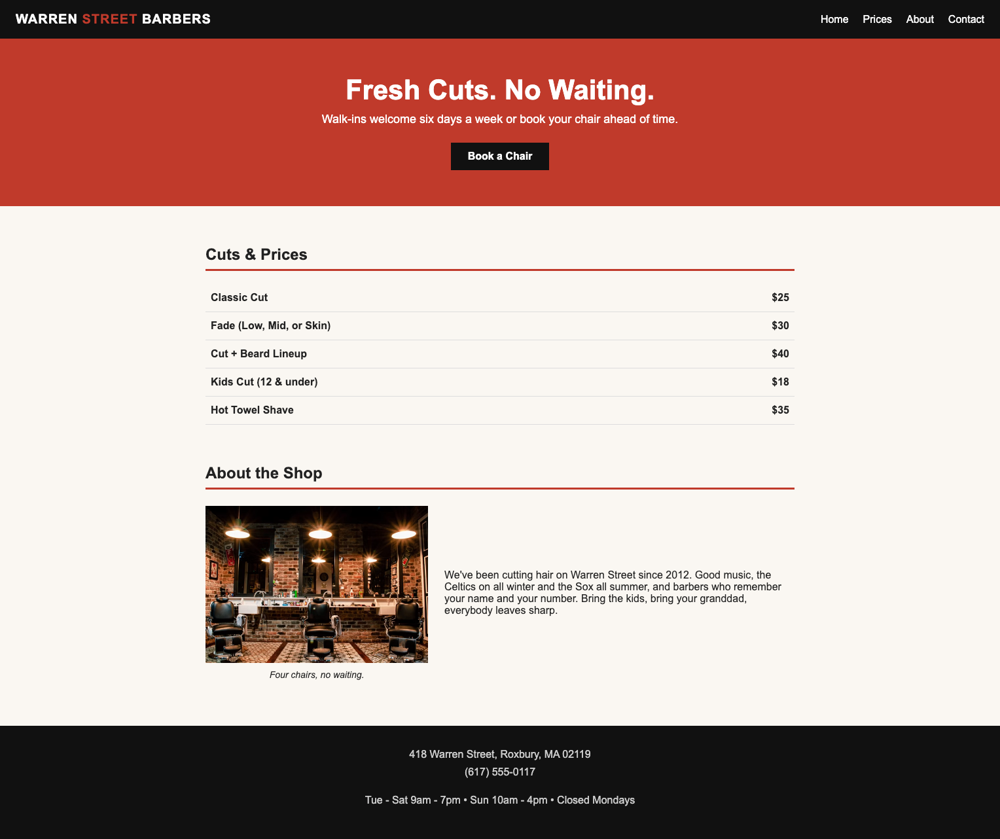

# 💈 Warren Street Barbers

A one-page website for Warren Street Barbers, a fictional neighborhood barbershop in Roxbury, Boston. The page has a header with navigation, a bold call-to-action banner for booking a chair, a price list for cuts and shaves, an "About the Shop" section with a photo, and a footer with the address, phone number, and hours.

## How It's Made:

**Tech used:**

  
  

The page is built with semantic HTML so each part of the site has a clear purpose: a `<header>` with a `<nav>` menu, a `<main>` section for the content, and a `<footer>` for the shop's contact info. The prices are in a `<table>` with `<th>` for each service and `<td>` for its price, and the shop photo uses `<figure>` and `<figcaption>` for its caption.

For the styling, I went with a black, red, and off-white color scheme to match a classic barbershop look:

- **Header:** a black bar with the shop name on the left (using `float`) and the nav links lined up on the right with `display: inline`. A `` highlights "STREET" in red.
- **Banner:** a full-width red section with a large headline and a black **Book a Chair** button styled from a plain link with padding and `display: inline-block`.
- **Price list:** a full-width table with `border-collapse` and light dividing lines between rows, with services aligned left and prices aligned right.
- **About section:** the photo sits on the left with its caption, and the shop's story is placed next to it.

## Optimizations

- Fix the shop photo. The `` path is missing the `images/` folder, so the picture doesn't load.
- Make the nav links work by adding matching `id`s to each section (e.g. `<section id="Prices">`), so clicking them scrolls to that part of the page.
- Make the layout responsive. Fixed sizes like `width: 1105px` and `padding-left: 210px` cause sideways scrolling on smaller screens. Using percentages, `max-width`, and media queries would fix it.
- Replace `float` and negative margins with Flexbox or CSS Grid for the header and About section, which would make the layout easier to adjust.
- Use the Roboto font that's already loaded from Google Fonts. Right now the CSS sets everything to Arial.
- Link the **Book a Chair** button to a booking page, phone number (`tel:`), or contact form.
- Credit the photo: _Photo by Nathon Oski on Unsplash_.

## Lessons Learned:

This project helped me practice building a real-looking business website from scratch with just HTML and CSS. I learned how semantic elements like `<header>`, `<nav>`, `<main>`, `<figure>`, and `<footer>` organize a page, and how a `<table>` is a good fit for something like a price list. On the CSS side, I practiced the box model, colors, and positioning, and I saw how fixed widths and floats can make a layout hard to manage. That showed me why Flexbox, Grid, and responsive design are worth learning.
